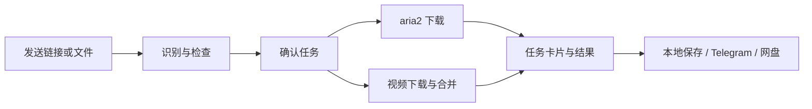

<div align="center">

# 📥 tg-aria2-bot

**把下载任务留给服务器，把操作留在 Telegram。**

链接与磁力下载 · 视频解析与合并 · 平台账号管理 · Web 后台

[](requirements.txt)
[](https://github.com/aria2/aria2)
[](#部署)
[](docs/VIDEO.md)

[快速开始](#快速开始) · [部署选择](#部署) · [视频与扫码](#视频与扫码) · [常见问题](#常见问题) · [完整参考](docs/REFERENCE.md)

</div>

---

发送下载地址，在确认卡片上点击开始。随后在聊天里查看进度、暂停或继续，下载完成后可发送到 Telegram，或交给 GoFile / rclone 处理。

普通下载由 [aria2](https://github.com/aria2/aria2) 执行；可选视频组件使用 [yt-dlp](https://github.com/yt-dlp/yt-dlp) 和 [you-get](https://github.com/soimort/you-get)，由 FFmpeg 完成音视频合并。附带业务管理后台与 AriaNg 面板。

## 你可以做什么

| 能力 | 使用方式 |
| :--- | :--- |
| 🔗 普通文件 | HTTP(S)、FTP、SFTP；不限扩展名，支持无扩展名地址 |
| 🧲 BitTorrent | 磁力链接、40 位裸 infohash、`.torrent` 文件 |
| 📑 Metalink | `.metalink` / `.meta4` 清单，按文件确认并跟踪任务 |
| 🎬 视频网页 | 自动识别常见站点，或使用 `/video URL`；选择画质、下载并合并 |
| 🔑 平台账号 | 个人 / 共享 / 未登录身份切换，查看已保存账号、重新扫码与移除 |
| 🎛 任务管理 | 卡片进度、列表筛选、搜索、暂停继续、失败重试和删除确认 |
| 🛡 用户管理 | 白名单、使用申请、个人额度、磁盘检查与告警 |
| ☁️ 后处理 | 发送到 Telegram、GoFile 上传、rclone 钩子与过期清理 |
| 🖥 多节点 | 一个机器人管理多个 aria2 实例，用户可选择目标节点 |

> SFTP 取决于 aria2 的编译能力。视频功能默认关闭，视频下载在机器人本机执行；各站点支持情况取决于解析器、登录状态和平台策略。

## 下载流程



菜单尽量在原消息内更新。打开操作确认时保留返回路径；从视频确认进入账号管理后，可返回原来的待确认任务。

## 部署

| 方式 | 适合谁 | 说明 |
| :--- | :--- | :--- |
| **源码 + systemd** | 希望直接管理 Python 服务 | 保留源码部署；支持安装可选视频和扫码组件 |
| **源码 + Docker Compose** | 希望隔离运行环境 | 在服务器构建容器，统一数据目录与依赖 |
| **固定版本镜像** | 希望服务器只拉镜像运行 | 发布后按版本与摘要部署，支持 amd64 / arm64 |

**第一次使用：** 选择熟悉的 systemd 或 Docker。希望减少服务器构建依赖时，再参考[固定镜像部署](docs/IMAGE_DEPLOYMENT.md)。不要交替使用不同入口管理同一套容器。

## 快速开始

准备一台 Linux 服务器，以及 Telegram 的 `BOT_TOKEN`、`API_ID`、`API_HASH` 和你的用户 ID。下载文件、媒体合并和本地 Bot API 均需要可用磁盘与网络。

```bash
git clone https://github.com/cuijianzhuang/tg-aria2-bot.git
cd tg-aria2-bot
```

<details open>
<summary><strong>源码 + systemd</strong></summary>

```bash
sudo bash tg-aria2.sh install --mode bare
```

按提示填写配置。已有安装会沿用现有配置。机器人由 systemd 管理；本地 Telegram Bot API 默认使用独立容器，完全无 Docker 的安装选项见[完整参考](docs/REFERENCE.md)。

同时安装视频下载与扫码：

```bash
sudo bash tg-aria2.sh install --mode bare --with-video-login
```

只需视频下载、不需要扫码时，将最后的选项换为 `--with-video`。

</details>

<details>
<summary><strong>源码 + Docker Compose</strong></summary>

```bash
sudo bash tg-aria2.sh install --mode docker
```

需要视频与扫码时：

```bash
sudo bash tg-aria2.sh install --mode docker --with-video-login
```

扫码浏览器运行在独立的 `video-login` profile 中；普通机器人镜像不包含 Chromium。

</details>

<details>
<summary><strong>固定版本镜像</strong></summary>

先由 GitHub Actions 发布对应版本的 bot、AriaNg 和可选 login 镜像，再按[部署文档](docs/IMAGE_DEPLOYMENT.md)配置 `.env` 并运行镜像部署脚本。

服务器不需要安装 Python 或编译视频依赖。镜像标签必须已成功发布，不能直接使用尚不存在的示例版本号。

</details>

安装完成后，在 Telegram 私聊机器人发送 `/start`。先测试一个小文件，再启用视频、扫码或网盘上传。

## 视频与扫码

### 🎬 下载视频

1. 启用视频组件，发送视频网页链接或 `/video URL`。
2. 在确认卡选择解析器、画质与账号身份，默认最佳画质。
3. 确认后下载，查看进度；必要时暂停、继续、取消或重试。

yt-dlp 解析失败时可由 you-get 兜底；下载开始后不自动切换。首版面向单视频，不提供播放列表批量下载或直播录制。暂停任务保留执行槽位。

YouTube、B站、抖音和小红书均支持 Netscape Cookie 文件：用户可在私聊平台账号页导入个人文件，
也可由管理员配置共享文件并开放共享。选好身份后再发送需要登录的视频链接。YouTube 不提供扫码登录。
[个人导入](docs/VIDEO.md#个人-cookie-导入) · [共享文件配置](docs/VIDEO.md#配置-cookie-文件四个平台通用)

### 🔑 管理登录账号

私聊发送 `/videoaccounts`，或点击菜单中的“平台账号”：

- 查看 B站、抖音、小红书的个人 / 共享账号、最近登录时间与默认身份。
- 重新扫码、切换使用身份；移除本机登录状态前需确认。
- 管理员可开放或关闭共享，个人账号失效时不会自动切换共享身份。
- Web 后台管理共享账号；个人扫码页通过私聊的一次性专属链接进入。

**已保存登录态不等于当前仍有效。** 平台额外验证、风控或页面变动可能影响扫码与下载，不承诺所有站点和内容都可用。完整配置、权限隔离、恢复与验收说明见[视频文档](docs/VIDEO.md)。

## 常用命令

| 命令 | 用途 |
| :--- | :--- |
| `/start` | 主菜单与状态总览 |
| `/list` · `/find 关键词` | 浏览、筛选与搜索任务 |
| `/video URL` | 解析单个视频网页 |
| `/videoaccounts` | 查看与管理平台账号，仅私聊 |
| `/quota` · `/stats` | 个人额度与下载统计 |
| `/rss` | 管理订阅与自动下载 |
| `/settings` | 管理员设置入口 |

更多命令、权限和选项见[完整参考](docs/REFERENCE.md#机器人命令)。

## 日常维护

在采用一键安装的服务器上：

```bash
sudo tg-aria2 status       # 查看服务状态
sudo tg-aria2 logs         # 查看机器人日志
sudo tg-aria2 update -y    # 更新并检查服务
sudo tg-aria2 backup       # 备份配置和数据库
```

固定镜像部署请使用[对应的升级与回退流程](docs/IMAGE_DEPLOYMENT.md#升级与回退)。启用扫码后，除数据库外还要备份 `data/video-private/key`；缺少原密钥将无法解密旧凭据。

## 常见问题

<details>
<summary><strong>点击“开始下载”没有反应，日志提示下载目录不存在？</strong></summary>

旧版本在磁盘检查时直接访问下载目录；目录在运行期间被移除后，会抛出 `FileNotFoundError`，中断按钮处理。
可先按 `.env` 的 `DOWNLOAD_DIR` 创建对应目录，再重试原确认卡，无需重装。例如 systemd 默认路径：

```bash
sudo mkdir -p /opt/tg-aria2-bot/downloads
```

新版在本机下载前自动补建缺失目录，并区分“目录不可用”和“磁盘空间不足”；失败时保留确认卡供重试。
远程 aria2 节点的目录仍由远端管理。若目录反复消失，还需核查服务器上的删除操作、清理脚本或挂载变化；
单条 `FileNotFoundError` 日志无法确定删除来源。

</details>

<details>
<summary><strong>提示“视频功能 / 扫码服务未启用”怎么办？</strong></summary>

普通更新不会自动安装可选组件。一键部署在项目目录重新运行 `install --with-video-login`，会沿用现有配置并安装所需组件。手动部署需设置 `VIDEO_ENABLED=true`、`VIDEO_LOGIN_ENABLED=true`，安装依赖并启动扫码 worker；修改配置后重启相关服务。

详见[视频安装说明](docs/VIDEO.md)。

</details>

<details>
<summary><strong>视频一直停留在 0 B？</strong></summary>

先更新到包含进度解析修复的版本，再继续或重试任务。新版能正确读取 yt-dlp 的未知进度字段，下载阶段默认连续 180 秒无字节增长会终止并显示原因。服务器网络、403、限流或账号权限问题仍需按具体提示处理。

</details>

<details>
<summary><strong>扫码成功后为什么仍无法下载某些视频？</strong></summary>

扫码只保存平台登录状态。可下载的内容与画质仍取决于账号权限、登录有效期、解析器支持和服务器网络。可以重新解析、调整画质或手动切换解析器。

</details>

## 文档导航

| 文档 | 内容 |
| :--- | :--- |
| [完整功能与运维参考](docs/REFERENCE.md) | 全量功能、命令、节点安装、部署参数和历史兼容说明 |
| [视频与扫码](docs/VIDEO.md) | 双解析器、账号管理、Cookie、运行时和验证边界 |
| [固定镜像部署](docs/IMAGE_DEPLOYMENT.md) | 版本发布、摘要锁定、自检、升级与回退 |
| [开发约定](CONTRIBUTING.md) | 模块边界、代码规范与测试方法 |

感谢 [aria2](https://github.com/aria2/aria2)、[P3TERX/aria2.conf](https://github.com/P3TERX/aria2.conf)、[yt-dlp](https://github.com/yt-dlp/yt-dlp)、[you-get](https://github.com/soimort/you-get)、[FFmpeg](https://ffmpeg.org/) 与 [AriaNg](https://github.com/mayswind/AriaNg) 等开源项目。
